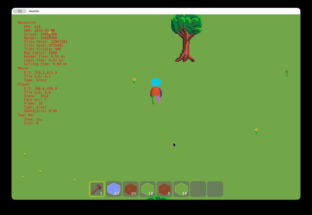

# HexVile
A 2D hexagonal tile-based game demo built with C++
and [Raylib](https://www.raylib.com/).



## Controls

- **W, A, S, D**: Move character.
- **1 - 9, 0**: Select toolbar slots.
- **Left Click**: Interact with the world (e.g., chop trees when Axe is
  selected).
- **I**: Toggle Inventory (Work in progress).
- **F**: Toggle Fullscreen mode.

## Prerequisites

To build and run HexVile, you need:

- A C++17 compatible compiler (GCC, Clang, or MSVC).
- [CMake](https://cmake.org/) (Version 3.10 or higher).
- OpenGL drivers.

## Building the Project

1. **Clone the repository**:

   ```bash
   git clone https://github.com/DseaKu/HexVile.git
   cd HexVile
   ```

2. **Create a build directory**:
_Note: Raylib is automatically fetched and compiled via CMake's `FetchContent`
module during the first build._

   ```bash
   cmake -B build
   ```

3. **Configure and build**:

   ```bash
    cmake --build  build
   ```

4. **Run the game**:

   ```bash
    ./build/game

   ```


